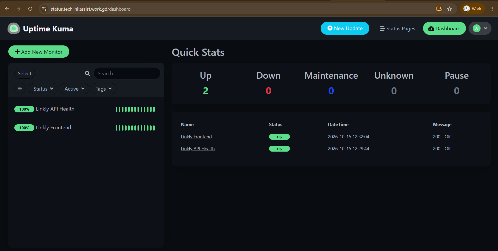
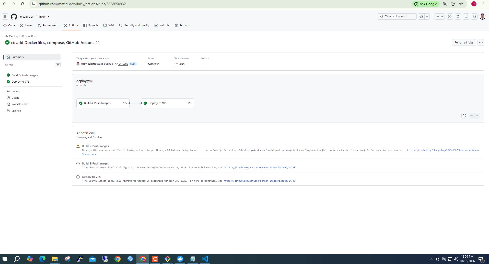

# 🔗 Linkly — Production-Grade URL Shortener SaaS

[](https://github.com/mazid-dev/linkly/actions/workflows/deploy.yml)


A production-ready URL shortener with click analytics, deployed on AWS with full CI/CD automation, SSL, and 24/7 monitoring.

> **Live Demo:** _Offline (AWS cost optimization). Full setup documented in [`docs/`](./docs)._


---

## 🛠️ Tech Stack

| Layer | Technology |
|-------|-----------|
| **Backend** | Node.js 20 + Express + TypeScript |
| **Frontend** | React 18 + Vite + TypeScript |
| **Database** | PostgreSQL 16 |
| **Cache** | Redis 7 |
| **Containers** | Docker + Docker Compose |
| **Proxy** | Nginx + Let's Encrypt |
| **Cloud** | AWS EC2 (Ubuntu) |
| **CI/CD** | GitHub Actions |
| **Monitoring** | Uptime Kuma |

---

## ✨ Highlights

### Application
- 🔐 JWT authentication (bcrypt hashing)
- 🔗 URL shortening (nanoid 7-char codes)
- 📊 Click analytics (IP, user-agent, timestamps)
- ⚡ Redis caching (<1ms redirects)
- 🩺 Health endpoint for monitoring

### Infrastructure
- 🐳 Multi-stage Docker builds (70% smaller images)
- 🔒 Non-root containers + VPS hardening
- 🌐 Nginx reverse proxy with IP-blocking
- 🔐 Auto-renewing SSL (Let's Encrypt)
- 🚀 Zero-downtime deploys with auto-rollback
- 💾 Daily automated backups
- 📈 24/7 uptime monitoring

---

## 🏗️ Architecture

```text
Users → Nginx (443, SSL) → Backend :3000 → PostgreSQL
                          ↘ Frontend :8080 → Redis
```

**CI/CD:** `git push` → GitHub Actions → Docker build → Docker Hub → SSH deploy → Live in ~2 min.

📖 **Full architecture:** [docs/ARCHITECTURE.md](./docs/ARCHITECTURE.md)

---

## 🚀 Quick Start

```bash
git clone git@github.com:mazid-dev/linkly.git
cd linkly
cp backend/.env.example backend/.env
cp frontend/.env.example frontend/.env
docker compose up --build -d
docker compose exec -T db psql -U linkly -d linkly < backend/migrations/001_init.sql
```

**Access:**
- Frontend: http://localhost:8080
- API: http://localhost:3000
- Health: http://localhost:3000/health

---

## 📸 Screenshots

| App | Monitoring | CI/CD |
|-----|-----------|-------|
|  |  |  |

---

## 📡 API Overview

| Method | Endpoint | Description |
|--------|----------|-------------|
| `POST` | `/api/auth/register` | Register new user |
| `POST` | `/api/auth/login` | Login & get JWT |
| `POST` | `/api/shorten` | Create short URL (auth) |
| `GET` | `/api/urls` | List user URLs (auth) |
| `GET` | `/:code` | Redirect to original |
| `GET` | `/health` | Health check |

📖 **Full API reference:** [docs/API.md](./docs/API.md)


---

## 🎯 Key Learnings

1. **"Works locally" ≠ "Works in production"** — env vars, DNS, SSL, permissions all matter.
2. **Every secret belongs in GitHub Secrets** — never in code.
3. **Health checks prevent 3 AM wakeups** — auto-rollback on failure.
4. **The 7-phase pattern is universal** — works for any language or cloud.

---

## 🗺️ Roadmap

- [x] Multi-stage Docker builds
- [x] VPS hardening + CI/CD
- [x] SSL + Nginx reverse proxy
- [x] Automated backups + monitoring
- [ ] Multi-environment (dev/staging/prod)
- [ ] Terraform Infrastructure as Code
- [ ] Kubernetes migration

---

## 👨‍💻 Author

**Md Mazid Hossain** — DevOps Engineer

[](https://github.com/mazid-dev)
[](https://www.linkedin.com/in/md-mazid-hossain-293561227/)

---

## 📄 License

MIT — see [LICENSE](./LICENSE)